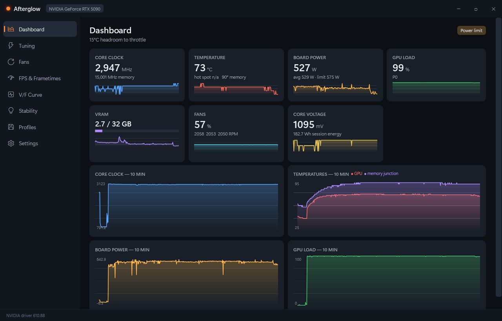
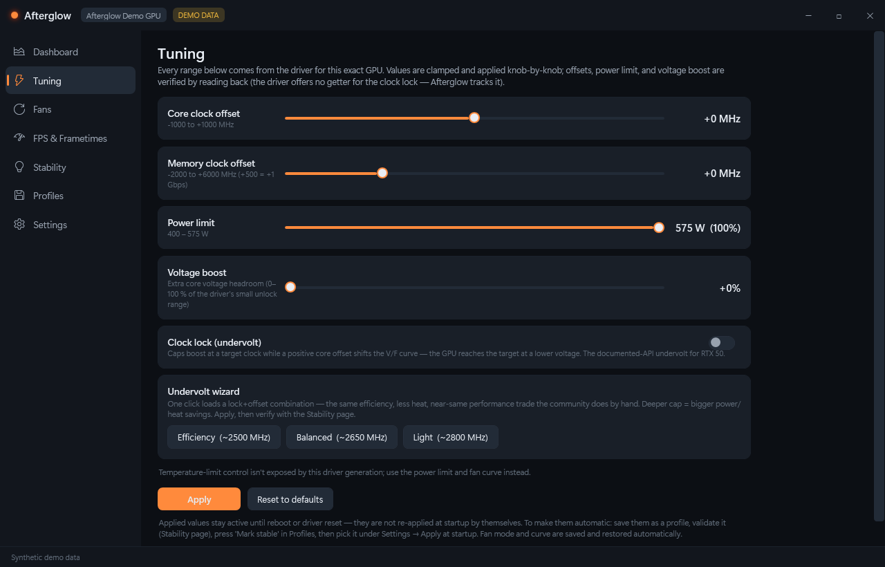
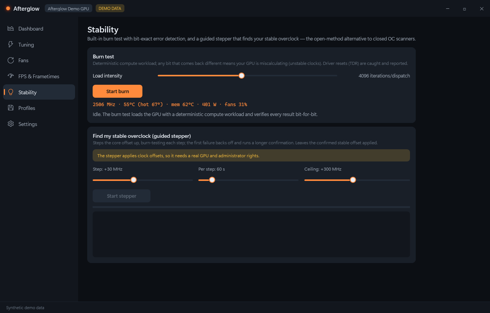
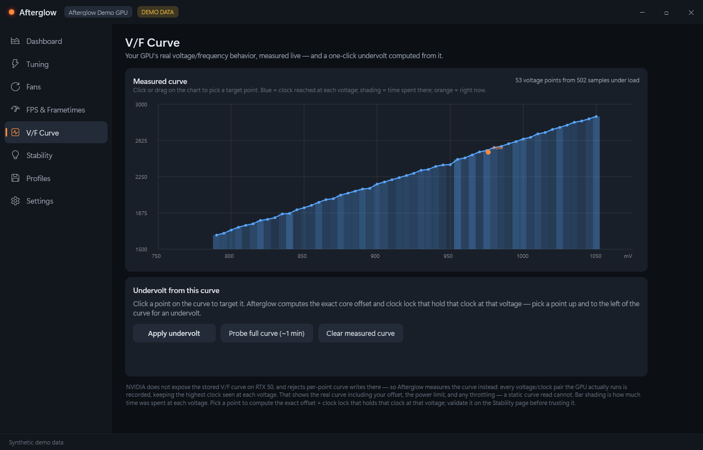
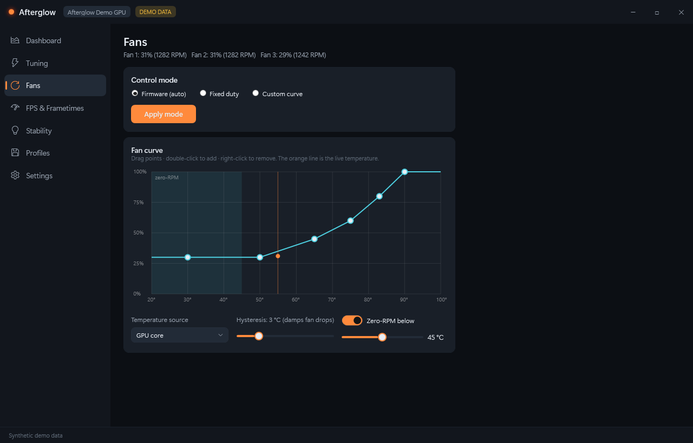
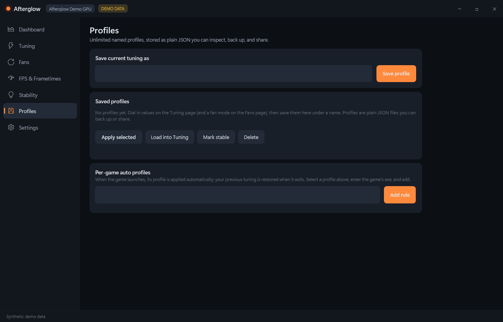
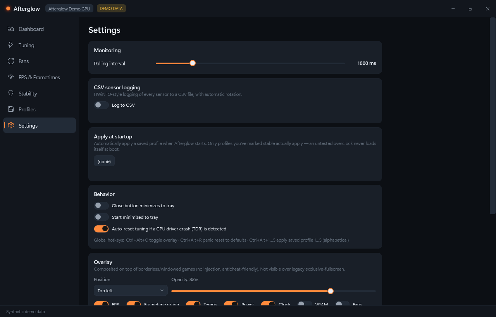

<p align="center">
  
</p>

<h1 align="center">Afterglow</h1>

<p align="center">
  <b>Free, open-source overclocking, undervolting, fan control and monitoring for NVIDIA RTX graphics cards.</b><br/>
  Intel Arc support in beta. No kernel driver, no telemetry, no account.
</p>

<p align="center">
  <a href="../../releases/latest"><b>Download for Windows</b></a> ·
  <a href="docs/features.md">All features</a> ·
  <a href="CHANGELOG.md">What's new</a>
</p>

<p align="center">
  
  <br/>
  <sub>The dashboard after ten minutes of ordinary desktop use on an RTX 5090.</sub>
</p>

---

## What it does

**Shows you what your card is doing.** Clock speeds, temperatures (including memory
junction on RTX 50 cards, which most tools can't read), power draw, voltage, fan speeds and
load, with ten minutes of history behind every number. When the card slows itself down,
Afterglow tells you why in plain words ("the board hit its power limit") and how many
degrees you have left before it starts throttling.

**Overclocks and undervolts, safely.** Every slider is limited to the range the driver says
is legal for your exact card, and each change is read back to confirm it actually took
(NVIDIA's clock lock is the exception: the driver can't report it, so Afterglow keeps track
of it and says so). To undervolt you can pick a preset, click a point on your card's
measured voltage/frequency curve, or edit the driver's curve point by point.

<p align="center">
  
</p>

**Runs your fans the way you want.** Draw a fan curve, pick which temperature drives it
(core, hot spot or memory junction), let the fans stop below a temperature, and stop them
hunting up and down with hysteresis.

**Tells you whether it's actually stable.** A built-in burn test checks its answers bit for
bit, so a single wrong bit is caught instead of waiting for a crash or for artifacts. There
is a test for video memory, a stepper that walks your overclock up until it finds the edge,
and a one-click certification that runs all four tests against a saved profile. If your PC
does crash, the next launch explains what was happening in the seconds before.

<p align="center">
  
</p>

**Measures frame rates without injecting anything.** Average FPS, 1% and 0.1% lows and a
frametime graph for whatever game is running, read from Windows' own present events (the
same method as NVIDIA FrameView and CapFrameX). No RivaTuner needed. Every capture is saved
with the settings you were running, so you can compare before and after.

**Remembers and automates.** Save settings as named profiles, have a profile switch on when
a game starts (and switch back when it closes), set a game's frame cap or vsync in the
NVIDIA driver, or write rules like "if the memory gets to 94 °C for 30 seconds, run the fans
at 90 %". `Ctrl+Alt+R` puts everything back to stock from anywhere (`Ctrl+Alt+F11` where
your keyboard layout types a character with `Ctrl+Alt+R`; every shortcut can be changed in
Settings).

**Works from scripts and AI agents too.** Everything is also in `afterglow-cli`, and
`afterglow-cli mcp` lets an AI agent monitor, tune and stability-test the card through the
Model Context Protocol, within the same limits as the app
([docs/agent-integration.md](docs/agent-integration.md)).

The full list, with how each feature works and where it was tested, is in
[docs/features.md](docs/features.md).

<table>
  <tr>
    <td></td>
    <td></td>
  </tr>
  <tr>
    <td align="center"><sub>V/F Curve: the driver's stored curve (gold) with the measured one on top as it builds up</sub></td>
    <td align="center"><sub>Fans: firmware, fixed or your own curve, driven by any temperature</sub></td>
  </tr>
  <tr>
    <td></td>
    <td></td>
  </tr>
  <tr>
    <td align="center"><sub>Profiles: saved, tested, certified, and per-game rules</sub></td>
    <td align="center"><sub>Settings: startup, logging, alerts, automation, overlay</sub></td>
  </tr>
</table>

<sub>All screenshots are real captures from an RTX 5090 on driver 617.42, made with
[tools/screenshots.ps1](tools/screenshots.ps1).</sub>

## Why another tuning tool?

- **No kernel driver.** The popular tools install one, and those drivers have a history of
  security holes: MSI Afterburner's `RTCore64.sys` has had several CVEs, one used by
  ransomware to switch off antivirus, and it is listed on [loldrivers.io](https://www.loldrivers.io/drivers/e32bc3da-4db1-4858-a62c-6fbe4db6afbd/)
  and has run into anti-cheat systems. Afterglow uses only the documented user-mode
  interfaces that come with the graphics driver: NVML and NVAPI from NVIDIA, IGCL and
  Level Zero from Intel.
- **Open source** under the MIT licence. You can read exactly what it does to your card.
- **Honest.** If your card or driver doesn't support something, Afterglow says so instead of
  showing a made-up number. Limits are listed below, and measurements come with their method.
- **Light.** Sitting in the tray it uses about 130 MiB of memory and about 0.3 % of one CPU
  core on the test machine, almost all of that being the driver answering the
  once-a-second sensor read ([docs/performance.md](docs/performance.md)).

## Intel Arc (beta)

The same app also runs on Intel GPUs, through Intel's own documented interfaces. Every
feature is checked against your exact device before it appears, so you only see what
your card and driver actually support.

On the one Intel GPU it has been verified on (an Arc B390 in a handheld), you get live
monitoring, the frequency clamp (Intel's driver can report it back, so every change is
confirmed), the full stability lab, profiles with certification and FPS capture. That
device has no temperature sensors, no fan control, no power-limit control and no clock
offsets, and Afterglow says so instead of guessing. Discrete Arc cards will likely offer
more. If you have one, please run `afterglow-cli selftest` and post the output in an
issue: your driver will answer differently than the one it was tested on. The details
are in [docs/research/intel-driver-apis.md](docs/research/intel-driver-apis.md).

## How it compares

| | Afterglow | MSI Afterburner | NVIDIA App | ASUS GPU Tweak III |
|---|---|---|---|---|
| Open source | **Yes (MIT)** | No | No | No |
| Kernel driver | **None** | RTCore64.sys | None | Yes |
| Manual clock offsets | Yes, checked against the driver | Yes | **No** | Yes |
| Undervolting on RTX 50 | **Measured curve + click-to-undervolt** | Curve editor | No | V/F tuner |
| Fan curve driven by memory temperature | **Yes** | No | No | No |
| Memory junction temperature on RTX 50 | **Yes** | Plugin | No | Unknown |
| Throttle reasons in plain language | **Yes** | No | No | No |
| FPS and 1%/0.1% lows without RTSS | **Yes** | Needs RTSS | 1% only | OSD |
| Per-game profiles that switch back | **Yes** | No | No | Profile Connect |
| Stress test that checks for errors | **Yes** | Separate app | No | Separate app |
| Automatic stability search | **Yes, open method** | OC Scanner | Auto-tune | OC Scanner |
| Reset after a driver crash | **Yes** | No | Manual | No |
| Command line | **Full** | Profile switching | No | No |
| Telemetry or account | **None** | None | Telemetry | Vendor services |

Researched against current releases in 2026; sources are in
[docs/research/competitive-landscape.md](docs/research/competitive-landscape.md).
Corrections are welcome.

## Getting started

1. **Install.** Download `Afterglow-x.y.z-setup.exe` from
   [Releases](../../releases/latest) and run it. Or take the portable zip, unzip it anywhere
   and run `Afterglow.exe` (keep the folder together). Windows 10 or 11, 64-bit, with NVIDIA
   driver 555 or newer (or a current Intel Arc driver). Nothing else to install.
2. **Accept the admin prompt.** Changing clocks, power and fans needs administrator rights,
   as it does for every tool like this. If you say no, Afterglow still runs and shows
   everything; it just can't change anything.
3. **Try a gentle undervolt.** On the Tuning page, pick *Balanced* in the undervolt wizard
   and press **Apply**. Your card should run nearly as fast on less power, which means cooler
   and quieter.
4. **Check it.** On the Stability page, run the burn test for a few minutes. If it reports
   an error, back off; if it passes, run the other two patterns too before you trust it.
5. **Keep it.** Save it as a profile, mark it stable, and choose it under
   *Settings → Apply a profile at startup*. Only profiles marked stable ever apply
   themselves, so an untested overclock can't load at boot.

Releases aren't code-signed yet, so Windows SmartScreen may warn the first time: choose
*More info → Run anyway*. Each release lists SHA-256 checksums you can check the download
against.

## Good to know

- **Made for NVIDIA RTX 20 series and newer**, tested most on RTX 50 (an RTX 5090).
  Intel Arc support is in beta and verified on one device so far (see above).
- **No hot-spot temperature on RTX 50.** NVIDIA blocks it in every public interface; tools
  that show it read hardware registers through a kernel driver, which Afterglow doesn't
  have. Memory junction temperature does work and is shown.
- **The per-point curve editor uses NVIDIA interfaces that aren't publicly documented**
  (the same ones Afterburner's curve editor uses). It's verified on an RTX 5090 and only
  appears when your driver answers. Applying a core offset rewrites the whole curve, so set
  the offset first and shape the curve after.
- **Per-game driver settings for games the driver doesn't know** create a small driver
  profile for the game. Versions up to 1.2.0-beta.4 had a bug that left a profile named
  "A" behind instead; `afterglow-cli drs --cleanup` finds it and, with `--apply` from an
  admin terminal, removes it.
- **The overlay can't draw over old-style exclusive fullscreen**, because nothing is
  injected into the game. Borderless, windowed and modern "fullscreen optimized" games work.
- **There's no temperature-limit slider** on current RTX 50 drivers through public
  interfaces; use the power limit and the fan curve instead.
- **More than one NVIDIA card** is supported (a selector appears in the title bar), but it
  hasn't been tested on a real two-card system yet ([#1](../../issues/1)).

## Command line

`afterglow-cli` comes with the app. Changes need an admin terminal.

```text
afterglow-cli selftest          what this GPU and driver support
afterglow-cli monitor           live sensors (--csv file to log them)
afterglow-cli caps | get        legal ranges / what is applied now
afterglow-cli set               --core-offset 150 --mem-offset 500 --power-limit 500
                                --lock-clock 2650 --fan 60 ...
afterglow-cli reset             back to driver defaults
afterglow-cli fps               frame rates of everything presenting
afterglow-cli stress            burn test (--pattern sustained|transitions|excursions)
afterglow-cli vram              video-memory test
afterglow-cli certify           all four stability tests against a saved profile
afterglow-cli drs               per-game driver settings (--exe game.exe --cap 120 --vsync off)
afterglow-cli drs --cleanup     find the "A" profile left by 1.2.0-beta.4 and earlier (--apply removes it)
afterglow-cli mcp               Model Context Protocol server for AI agents
```

Run `afterglow-cli help` for everything else.

## Building from source

```bash
git clone https://github.com/minewefu/afterglow
cd afterglow
dotnet build        # needs the .NET 10 SDK
dotnet test
dotnet run --project src/Afterglow.App -- --demo
```

`--demo` runs the whole app on a pretend GPU, so you can work on the interface without an
NVIDIA card. `--data-dir <folder>` keeps all settings, profiles and logs in that folder
instead of `%ProgramData%\Afterglow`, so a test build never touches your installed copy.
The `tools` folder has the scripts that make the screenshots above
([screenshots.ps1](tools/screenshots.ps1)), check the interface
([ui-check.ps1](tools/ui-check.ps1)) and measure performance
([measure-perf.ps1](tools/measure-perf.ps1)). Design rules: [docs/design.md](docs/design.md).

## Safety

Afterglow only writes values the driver itself says are legal for your card, and reads each
one back wherever the driver allows it. Clock and power settings don't survive a reboot
unless you choose a startup profile. If the driver crashes while you're tuned, Afterglow resets to stock; if the PC
crashes, the next launch offers to. Overclocking is still overclocking: you own the risk,
and an error in the stress test means back off.

Which driver interfaces are used, and how each was verified on real hardware:
[docs/research/driver-apis.md](docs/research/driver-apis.md).

## Credits

- Intel **PresentMon** (MIT) does the frame capture; the bundled binary, its licence and
  its pinned hash are in `ThirdParty/PresentMon` and [THIRD_PARTY.md](THIRD_PARTY.md).
- **LibreHardwareMonitor** and **NvAPIWrapper** published the NVAPI knowledge the interop
  layer was built from (no code copied).
- Intel's published **IGCL** and **Level Zero** headers (MIT) for the Intel structure
  layouts (no code copied).
- **CapFrameX** and Gamers Nexus for the frame-metric definitions.

MIT licensed. Not affiliated with or endorsed by NVIDIA or Intel.
